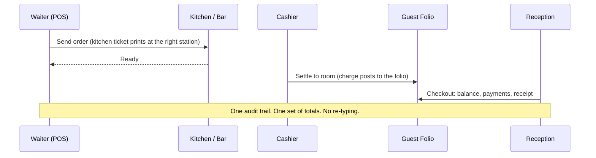
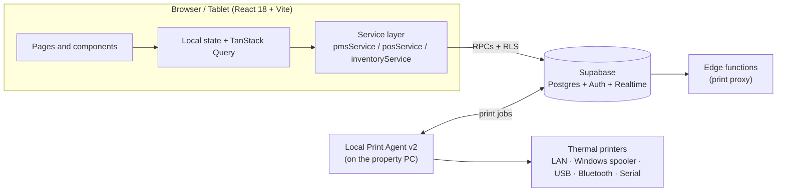

<div align="center">

# OliTechs PMS + POS

### One platform for the front desk, the dining room and the stockroom.

**The all-in-one property management and point-of-sale system built for hotels, lodges and beach resorts in Africa.**
Rooms, reservations, folios, kitchen tickets, stock and the nightly close, all in one place, all talking to each other.

[](https://github.com/olitechs/olitechpmspos/actions/workflows/validate-build.yml)


**[Live demo](https://olitechpmspos.vercel.app)** · **[Architecture](Architecture.md)** · **[Product requirements](PRD.md)** · **[Roadmap](FEATURE_ROADMAP.md)**

</div>

---

## Why this exists

A guest orders grilled snapper on the terrace, signs it to Room 7, and checks out two days later. In most properties that one sentence touches three systems, two notebooks and a calculator, and someone loses an hour reconciling it at night.

OliTechs is built so that sentence is **one transaction**:



---

<!--
SCREENSHOTS: capture these three screens and save them in docs/screenshots/, then uncomment this block.

| Dashboard | Room Planner | POS |
| --- | --- | --- |
|  |  |  |
-->

## What's in the box

### Front Office (PMS)
| | |
|---|---|
| **Room Planner** | Visual calendar of rooms against dates, drag to move or extend a stay, availability checked in the database so double bookings are rejected at the source |
| **Reservations** | Create, edit, cancel; multi-room group bookings; walk-in check-in; rate plans and room types |
| **Guest folios** | Room charges, restaurant charges, payments, balance, and a checkout that checks the balance first |
| **Housekeeping** | Clean, dirty, inspected and out-of-order states that follow check-out automatically; maintenance tickets; laundry orders |
| **Night audit** | Pre-check, run, history, and a managed business date per property |
| **Guests and loyalty** | Guest profiles, stay history, loyalty points |
| **Channels** | Booking-engine and channel-manager tables and sync events |

### Restaurant, Bar and Counter (POS)
| | |
|---|---|
| **Tables and orders** | Table sessions, order taking by category, modifiers, discounts, move and merge tables |
| **Kitchen display and tickets** | Kitchen order tickets, refire, item removal recorded as a void (never a silent delete) |
| **Payments** | Configurable payment types per property, room charge to folio, receipts |
| **Cashier shifts** | Open and close shifts, cash drawer, reconciliation against actual transactions |
| **Printing** | Local Print Agent v2, printer groups, routing by category to the right station |

### Stores and Inventory
Items, categories, suppliers, purchase orders and goods received, stock transfers between locations, adjustments with reasons, wastage, counts with reconciliation, production runs, recipes that deduct ingredients on sale, low-stock alerts and valuation.

### Platform, Roles and Licensing
- **Platform admin** (the OliTechs owner layer): approve properties, assign packages, enforce module access and usage limits.
- **Hotel admin**: staff, roles and property settings.
- **Operational roles**: receptionist, front office manager, waiter, cashier, POS staff, F&B manager, store manager, housekeeping supervisor, each seeing only what they should.
- **Row Level Security** in Postgres decides who reads and writes what, per property.

---

## How it fits together



The rule that keeps it honest: **components never call Supabase directly.** They go through hooks and the service layer, and money and stock changes run as database functions inside transactions.

---

## Quick start

**Requirements:** Node.js 18 or newer, a free [Supabase](https://supabase.com) project.

```bash
# 1. Clone
git clone https://github.com/olitechs/olitechpmspos.git
cd olitechpmspos

# 2. Install
npm install

# 3. Configure
cp .env.example .env.local
#    then set VITE_SUPABASE_URL and VITE_SUPABASE_ANON_KEY
#    (Supabase dashboard -> Project Settings -> API)

# 4. Apply the database
#    Run the SQL files in supabase/migrations/ in timestamp order.
#    See supabase/migrations/README.md for the platform-owner setup.

# 5. Run
npm run dev
```

The anon key is safe in frontend code by design. Row Level Security is what protects the data. **Never put the service-role key in the browser.**

### Where to go once it is running

| Surface | Path | For |
|---|---|---|
| Back office | `/backoffice` | Dashboard, items, reports, inventory, employees, settings |
| Front office | `/frontoffice` | Room planner, reservations, folios, housekeeping, night audit |
| Stores | `/stores` | Stock and purchasing |
| POS | `/pos` | Restaurant, bar and cashier |
| Platform admin | `/admin` | Properties, packages, audit log, roles, printers |

New properties register through the sign-up flow and wait for platform approval before they are active.

---

## Print Agent

Thermal receipts and kitchen tickets are printed by a small agent that runs on the property PC.

```bash
npm run print-agent
# listens on http://127.0.0.1:8631   health: /health
```

Supported connections: LAN/IP (ESC/POS on port 9100), Windows installed printers (including USB and paired Bluetooth), WebUSB, Web Bluetooth and Web Serial. Windows install scripts are in `tools/print-agent/`. Full guide: [`tools/print-agent/README.md`](tools/print-agent/README.md).

Agent settings (`PRINT_AGENT_ID`, `WORKSPACE_ID`, `SUPABASE_SERVICE_ROLE_KEY`) belong on the property PC only.

---

## Project structure

```text
olitechpmspos/
├── src/
│   ├── pages/            Route-level screens (POS, auth, admin, public)
│   ├── components/
│   │   ├── modules/      Dashboard, Reservations, Folio, Housekeeping, Reports...
│   │   ├── pms/          Room planner and room management
│   │   ├── pos/          Floor plan, order taking, POS container
│   │   ├── store/        Stores and inventory screens
│   │   ├── settings/     Back-office settings
│   │   ├── shell/        Sidebar, top bar, tabs
│   │   └── ui/           Shared primitives (button, input, dialog...)
│   ├── services/         Supabase access: pms, pos, inventory, auth, printers
│   ├── data/             PmsStore and AppStore (being migrated), palettes
│   ├── lib/              Auth context, query client
│   └── hooks/
├── supabase/
│   ├── migrations/       Ordered, additive SQL (schema, RLS, RPCs)
│   └── functions/        Edge functions (print proxy)
├── tools/print-agent/    Local Windows print agent
├── design-system/        Design tokens and page specs
├── tests/                Automated tests
└── docs/                 Production QA notes
```

> `v6/` is a historical copy kept for reference. It is not the running application.

---

## Scripts

| Command | What it does |
|---|---|
| `npm run dev` | Start the Vite dev server |
| `npm run build` | Production build |
| `npm run preview` | Serve the production build locally |
| `npm run lint` | ESLint |
| `npm run typecheck` | Type-check against `jsconfig.json` |
| `npm run print-agent` | Start the local print agent |
| `npm run print-agent:install` | Install the agent as a Windows service |

---

## Quality gates

Three GitHub Actions workflows run on the repository: **Validate OliTechs PMS POS** (build), **OliTechs Production QA**, and **Deploy Supabase Edge Functions**. The production QA checklist lives in [`docs/PHASE_10_PRODUCTION_QA.md`](docs/PHASE_10_PRODUCTION_QA.md).

---

## Engineering ground rules

These keep a money-handling system trustworthy. Read [`Rules.md`](Rules.md) before contributing.

- Postgres is the source of truth. React state is a view.
- No Supabase calls from presentational components.
- Migrations are additive and idempotent. Never edit or renumber an applied migration.
- Money is never trusted from the client. Totals, refunds and stock movements are computed and recorded by database functions.
- Voids and refunds leave an audit trail. Nothing already sent to the kitchen disappears silently.
- Permissions are enforced in the backend, not just by hiding buttons.
- New forms use `react-hook-form` and `zod`.

---

## Documentation

| Document | Purpose |
|---|---|
| [`PRD.md`](PRD.md) | What we are building and for whom |
| [`Architecture.md`](Architecture.md) | Target architecture and migration plan |
| [`Rules.md`](Rules.md) | Engineering rules |
| [`Phases.md`](Phases.md) | Delivery phases |
| [`Design.md`](Design.md) | Design system |
| [`Memory.md`](Memory.md) | Decisions and project memory |
| [`AGENTS.md`](AGENTS.md) | Guide for AI coding agents working in this repo |
| [`FEATURE_ROADMAP.md`](FEATURE_ROADMAP.md) | Feature roadmap |

---

## Roadmap

**In progress**
- A single design system and application shell (one navigation, one palette, shared components)
- Moving PMS and POS state from the legacy in-memory stores to TanStack Query and Zustand
- Moving authentication fully onto Supabase Auth

**Planned**
- Floor-plan editor: multiple dining areas, drag-to-arrange tables, saved layouts
- Richer order entry: course control, half portions, weight items, split by item or seat
- Barcode scanning at the till and at goods-in, shelf labels
- Departments with tax rates, second selling price, date-activated price lists
- Receipt and invoice history with reprint and approved reversals
- Sales analysis by item, department, operator, shift and hour; gross-to-net reporting
- Petty-cash and expense book linked to the cashier float
- Kenyan tax invoicing (KRA / ETR) integration
- Full offline operation with a safe sync queue
- End-to-end browser tests across reservation-to-checkout and order-to-settlement

---

## Contributing

1. Read [`AGENTS.md`](AGENTS.md), [`Rules.md`](Rules.md) and [`Phases.md`](Phases.md).
2. Branch from `main`: `feature/<phase>-<short-name>`.
3. Keep changes inside one phase. Run `npm run build`, `npm run lint` and `npm run typecheck` before opening a pull request.
4. In the pull request, list the changed files, the workflows you tested and anything you could not verify.

---

## License

MIT.

<div align="center">

**Built by [OliTechs](https://github.com/olitechs) for the people who run the property, not just the software that tracks it.**

</div>
